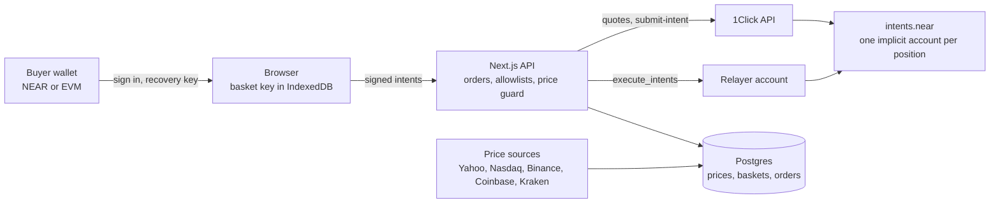

# nearbags

Creator-made baskets of tokenized US stocks, crypto and NEAR meme coins, bought in one step from any token on any chain through NEAR Intents. Baskets can be run by an AI agent in sealed hardware, with a proof for every decision. Every basket position lives in its own NEAR Intents account that only the buyer's keys can move.

- Live: https://nearbags.com (called Stonkbag until 2026-11-11; https://stonkbag-iota.vercel.app still works)
- Community: [X @nearbags](https://x.com/nearbags) · [Telegram group](https://t.me/+rIPcPygY_ehhMGZl)
- Built at NEAR HACKATHON (2026-11-01 to 2026-11-14). Tracks: `defi` (Unstoppable DeFi) and `thesis` (Investment Thesis).
- New project, started in the hackathon window. No earlier product on any chain.
- Docs: [how it works](docs/how-it-works.md), [fees](docs/fees.md), [safety](docs/safety.md), [AI agent baskets](docs/agent.md), [prices and numbers](docs/data.md), [architecture](docs/architecture.md), [operations](docs/operations.md).

## The problem

Buying a theme ("AI picks and shovels", "gold and bitcoin") means many separate trades, on different venues, often on different chains. Tokenized US stocks now exist (Ondo Global Markets), but buying five of them plus some BTC still means bridging, swapping each one, and tracking the result by hand. People who are good at picking themes have no simple way to publish one that others can buy.

## What nearbags does

1. A creator picks up to 10 assets (19 Ondo stocks and ETFs, 9 crypto assets, USDC, and the NEAR meme coins HOOT, NEARLY and IMEME), sets weights and a fee of 0–1%, and writes a short thesis. The studio shows a backtest while they build.
2. A buyer pays with whatever they hold (for example USDC on Base, ETH on Arbitrum, SOL). 1Click turns it into USDC inside a NEAR Intents account made for that position, then buys every asset at its weight.
3. The buyer can sell 25–100% back to any token on any chain, reset to the target weights, or withdraw the real underlying tokens (for example TSLAon on BNB Chain).
4. Optionally, the creator hands the weights to an agent: one of six rules (Fixed Mix, Equal Weight, Risk Balanced, Trend Guard, Volatility Target, Momentum Tilt) or their own strategy for an AI model. It runs daily on [OutLayer](https://outlayer.ai) in Intel TDX, and a separate signer, whose key only exists inside that hardware, signs each holder's swaps after checking them. Holders opt in when they buy; the agent can only swap inside their account.

## How NEAR is used

| Piece | How |
|---|---|
| NEAR Intents (`intents.near`) | Each position is an implicit account (64-hex id from an ed25519 public key). It holds the basket's tokens. Every swap, fee and withdrawal is a signed intent. |
| 1Click API | Cross-chain deposits, swaps and payouts. Buy legs use `INTENTS` deposit and recipient types, so funds never leave the basket account between steps. |
| Intent signing | Basket keys sign `raw_ed25519` payloads in the browser. Wallets sign `erc191` (EVM) or `nep413` (NEAR) payloads to add a key or recover an account. |
| Relayer | A platform NEAR account that pays gas for `execute_intents` on already-signed payloads. It holds no user funds and can't sign for users. Every batch is simulated first. |
| Rhea DCL | Meme coins (not on 1Click) swap on Rhea's concentrated-liquidity pools straight from the position account: one `ft_withdraw` intent to `dclv2.ref-labs.near` with a `client_echo` back to the same account. |
| OutLayer (TEE) | The agent's strategist and signer run as attested WASI modules, called on-chain from the relayer. The signer's ed25519 key is bound to its build; every decision and signature links to an attestation. |
| NEAR wallets | HOT Connect (HOT, Meteor, NEAR Mobile, Intear, OKX, Ledger and more) for sign-in with NEP-413. EVM wallets sign in with SIWE-style messages. |

No custom contract: everything runs on `intents.near`, 1Click, Rhea's DCL and OutLayer.

## Keys and custody

- **Basket key.** Made in the browser. Either derived from one wallet signature (HKDF of the signature, so any device can rebuild it) or random per basket (when the wallet's signatures aren't deterministic). It is stored in IndexedDB, encrypted with a non-extractable AES key. The server never sees it.
- **Recovery key.** Before the first deposit, the basket key adds the buyer's wallet key to the account (`add_public_key`). The wallet can always move the funds, even if nearbags disappears.
- **New device.** If a browser doesn't hold the basket key, the wallet signs one `add_public_key` for a fresh browser key. The relay route only allows that exact intent, for the user's own account, signed by the user's own wallet key.

## Try it (do X → see Y)

On the live demo (no wallet needed for 1–5):

1. Open https://nearbags.com → the hero chart draws five real price lines and merges them into one basket line. Hover it to read the value on any date.
2. Click **BROWSE BAGS** → `/explore` lists the seed baskets, with backtested return, minimum buy and fee.
3. Open **Degen Mix** (`/b/degen-mix`) → price-history chart against SPY and BTC, drawdown, per-asset contribution, correlation grid, thesis, risks and exit signal.
4. Switch the backtest window (1Y / 3Y / 5Y / MAX) and tick the monthly-rebalance box → the chart and stats switch to that window, and a dashed line shows the rebalanced version.
5. Open **CREATE** (`/create`) → pick assets and weights → the preview backtest and minimum buy update as you type.
6. Connect a wallet (NEAR or EVM), enter an amount on a basket page, and press **CHECK PRICES** → a review shows each leg's quote from 1Click, the fees, the price-guard result against live reference prices, and the minimum buy.
7. Press **BAG IT** → the app makes or unlocks the basket key, registers the position and adds your wallet as a recovery key, then shows a deposit address.

Steps 7 onward need the relayer account to be configured on the deployment. Until then the app stops with "Relayer is not configured" before any funds are asked for.

From a clone (no funds, no gas, read-only calls to NEAR mainnet):

```sh
pnpm install
pnpm test                                        # unit tests: backtests, keys, guards, fees, signing, thesis aggregation
pnpm tsx scripts/verify-keys-mainnet.ts          # a derived basket account adds EVM and NEAR recovery keys (simulate_intents)
pnpm tsx scripts/verify-wallet-sign-mainnet.ts   # an EVM wallet (ERC-191) and a NEAR wallet (NEP-413) each authorize a new browser key
```

Expected output of the last command:

```
ERC-191: OK (both keys added)
NEP-413: OK (both keys added)
```

## Safety checks in the buy flow

- **Price guard.** Each leg's 1Click price is compared with a live reference: median of several sources (Yahoo, Nasdaq, Twelve Data for stocks; Binance, Coinbase, Kraken, CoinGecko for crypto). For Ondo tokens the reference is multiplied by the token's shares-per-token, which is derived from dividends. Above 1.5% the app warns; above 5% it blocks. Outside US market hours the limits widen to 3% and 8%.
- **Minimum sizes.** Each asset has a minimum leg size found by probing 1Click. Each basket's minimum buy is derived from them.
- **Server allowlists.** The server only relays or submits payloads it built or expected: fee transfers must match the order exactly, and swap payloads must match the stored 1Click quote byte for byte.
- **Region rules.** Sanctioned regions are blocked. Where Ondo stocks aren't allowed (US, Canada and others), only crypto-only baskets can be bought. Restricted regions (EEA, UK, Switzerland, Singapore and others) require a professional-investor attestation.

## Backtests

- Daily prices from at least two sources per asset, combined by median, with outliers over 0.5% flagged.
- Dividends are reinvested net of 30% US withholding, the way Ondo tokens do. Price-only returns would understate income ETFs such as SGOV.
- Stats: CAGR, max drawdown, volatility, Sharpe, per-asset contribution, correlations, diversification ratio. Code is in `src/lib/analytics/backtest.ts`, with tests next to it.

## Investment thesis track

The claim: people will buy US stocks through NEAR Intents, but only when an app packages it, and the demand fades when the push stops. That makes distribution, not rails, the gap nearbags fills.

We started from "tokenized US stocks are becoming a real use of NEAR Intents". Explorer API data rejected it: Ondo stock volume through 1Click peaked in one week, almost all routed by a single app, and then fell more than 90%. `THESIS.md` and `/thesis` show the numbers, the evidence against the new claim, and what would change our mind. `pnpm thesis` rebuilds every number from raw API data.

## Architecture



| Path | What |
|---|---|
| `src/lib/intents/` | Keys, payload building and signing (raw_ed25519, ERC-191, NEP-413), RPC views |
| `src/lib/trade/` | Order state machine (buy, sell, reset, withdraw), preflight, price guard, portfolio |
| `src/lib/oneclick.ts`, `src/lib/relayer.ts` | 1Click client, gas relayer |
| `src/lib/prices/`, `src/lib/analytics/` | Price ingest, medians, total return, backtests |
| `src/lib/client/` | Browser key store, wallet sign-in, order runner |
| `src/app/api/` | HTTP routes |
| `scripts/` | Migrations, price ingest, seeding, mainnet checks |

## Run locally

```sh
pnpm install
cp .env.example .env.local   # DATABASE_URL, SESSION_SECRET and CRON_SECRET are enough to browse
pnpm db:migrate
pnpm prices:ingest           # about 2 minutes: 5 years of daily prices and dividends
pnpm db:seed                 # the seed baskets
pnpm dev
```

Optional env: `ONECLICK_JWT` (no 0.2% 1Click fee), `RELAYER_ACCOUNT_ID` and `RELAYER_PRIVATE_KEY` (needed to execute buys), `PLATFORM_FEE_ACCOUNT`, `TWELVEDATA_API_KEY`, `NEXT_PUBLIC_WALLETCONNECT_PROJECT_ID`, `EXPLORER_JWT` (thesis data).

## Libraries

Next.js 16, React 19, Tailwind CSS 4, drizzle-orm with postgres.js (Neon in production), TanStack Query, near-api-js 7 on the server, HOT Connect (@hot-labs/near-connect) for NEAR wallets, wagmi 3 and viem, @noble/curves, @noble/hashes, @scure/base, jose, zod, lightweight-charts, vitest, tsx. Hosted on Vercel.

AI coding tools (Claude Code) were used during the build.

## Limits

- Ondo stock tokens follow Ondo's rules: they are not for US persons, and some regions are restricted. The app enforces this with a geoblock and self-attestation, not KYC.
- Stock-token liquidity is thinner outside US market hours, so legs can be blocked by the price guard at night and at weekends.
- Small buys hit 1Click minimum sizes. Some ETFs need about $30 per leg.

## License

MIT
