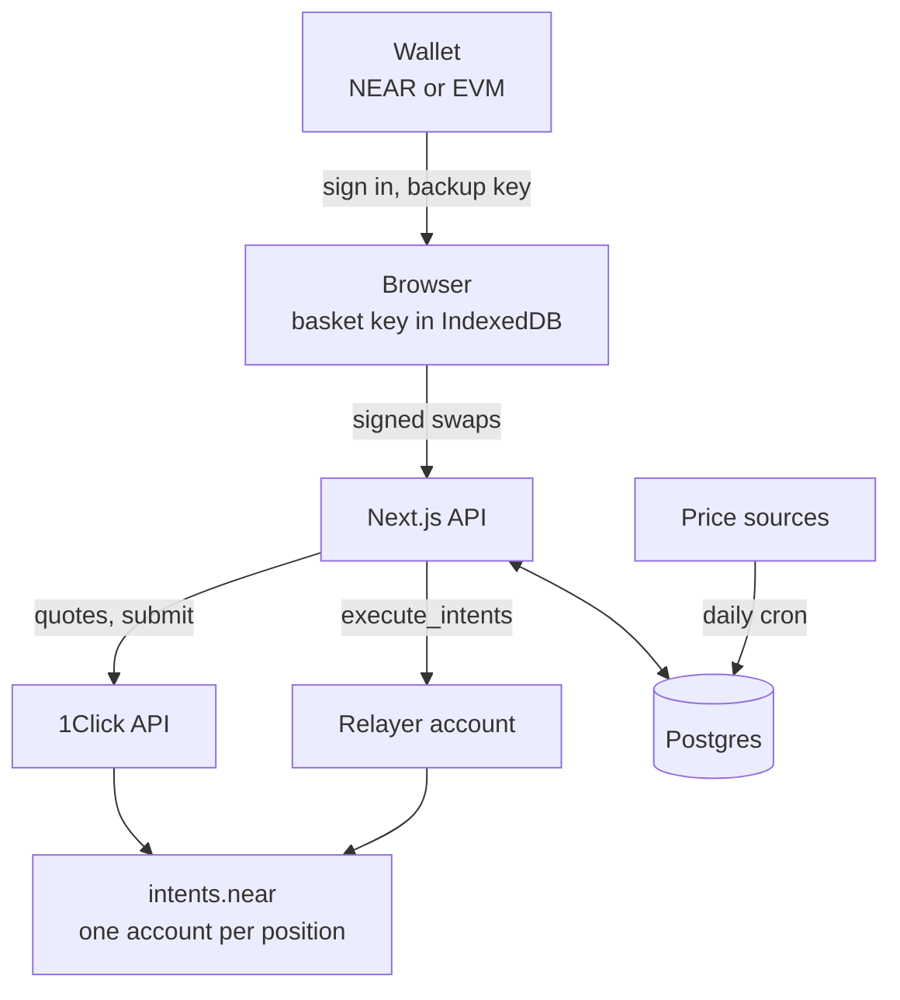
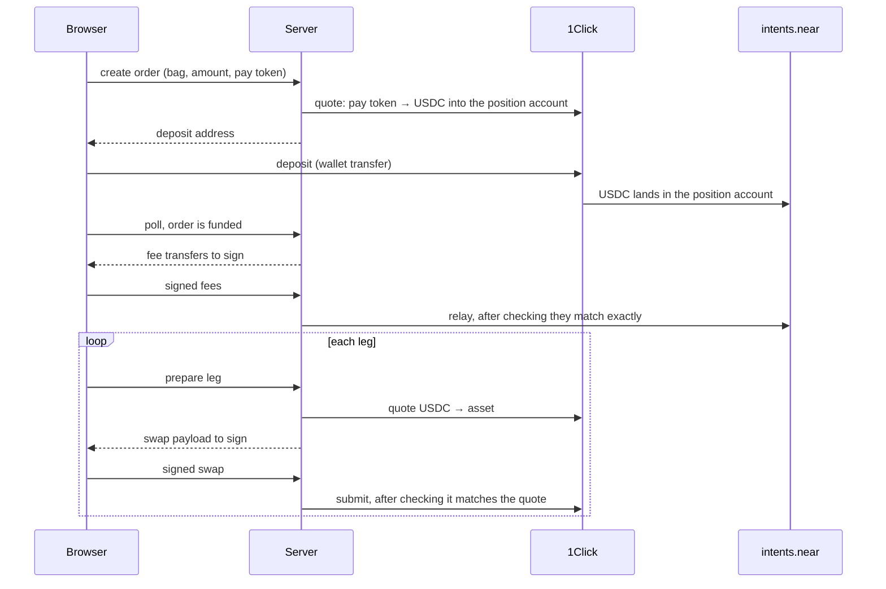
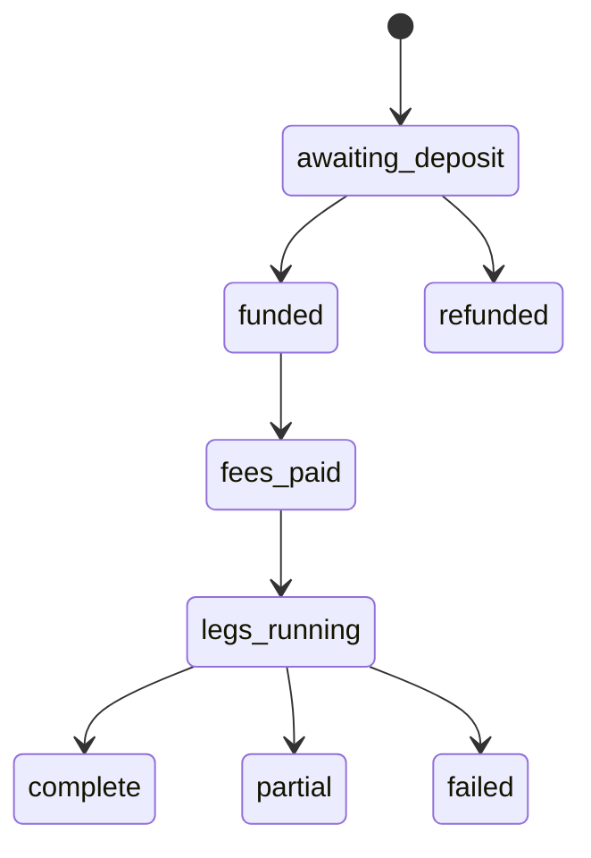

# Architecture

One Next.js app on Vercel, one Postgres database (Neon), and two NEAR Intents services, plus Rhea's DCL contract for meme coins. There is no custom smart contract.

| Part | Job |
|---|---|
| Browser | Holds the basket key, signs every swap, drives the order step by step |
| Next.js API | Quotes, builds what the browser must sign, checks signed payloads, tracks orders |
| 1Click | Cross-chain deposits, swaps and payouts |
| Rhea DCL (`dclv2.ref-labs.near`) | Meme coin swaps (HOOT, NEARLY), straight from the position account |
| `intents.near` | Holds every position's tokens, one implicit account per position |
| Relayer | A NEAR account that pays gas. Holds no user funds and can't sign for users. |
| Postgres | Users, bags, positions, orders, prices |

## A buy, step by step

A sell runs the same legs in reverse (asset → USDC), then one payout leg from USDC to the buyer's chosen token and address. Sells have no fee step.

## Meme coin legs (Rhea)

A leg that touches HOOT or NEARLY skips 1Click:

1. The server quotes it with the DCL contract's `quote` view (USDC → wNEAR → meme in one multi-hop, or back), and builds one `ft_withdraw` intent: the input token to `dclv2.ref-labs.near`, with a `Swap` message whose `min_output_amount` is the quote less 2% and whose `client_echo` is the position account.
2. The browser signs that payload with the basket key, as for any leg.
3. The server checks it (one withdrawal, approved pools, planned token, amount and output, `client_echo` = signer) and relays it with `execute_intents`.
4. `intents.near` sends the token to Rhea, Rhea swaps and sends the output back to `intents.near` for the same account. If the minimum isn't met, Rhea refuses and the input is credited back.
5. The server waits for the transaction to finish and reads the result from its logs (`mt_mint` to the account), with a balance check as fallback.

Rhea legs run one after another, not in parallel. Meme coin prices are the pool's mid × NEAR/USD, checked against DexScreener and GeckoTerminal; daily history comes from GeckoTerminal. Withdrawing a meme coin is a plain `ft_withdraw` to the holder's NEAR account.

## Order states

Orders are `buy`, `sell`, `reset` or `withdraw`. Each leg has its own status: `pending → quoted → submitted → success | refunded | failed`. A refunded or failed leg can be retried. A leg quoted but not submitted for over a minute is quoted again.

A new bag starts as `pending` and goes `live` when its creator's own buy completes. Creators can then `close` it. Admins can `hide` it.

## Signing

| Who signs | Format | For |
|---|---|---|
| Basket key | `raw_ed25519` | Every swap and fee transfer |
| EVM wallet | `erc191` | Sign-in, adding a backup or device key |
| NEAR wallet | `nep413` | Same |

The basket key is either derived from one wallet signature (same key on any device) or random per position when the wallet's signatures can't be reproduced. It is stored in IndexedDB, encrypted with a key the browser won't export.

## Database

| Table | Holds |
|---|---|
| `users` | Wallet address, chain, handle, profile |
| `baskets`, `basket_assets`, `basket_edits` | Bags, their weights, and a log of text edits |
| `positions` | One per user per bag, with its `intents.near` account id |
| `orders`, `order_legs` | Every buy, sell, reset and withdraw, and each swap inside it |
| `fee_events` | Creator and platform fee transfers |
| `price_daily`, `price_median`, `dividends` | Raw prices per source, the daily median, dividends |
| `snapshots` | Daily bag size and holder count |
| `settings`, `audit_log` | Admin switches and every admin action |
| `auth_nonces` | One-time sign-in challenges |

## API

| Area | Routes |
|---|---|
| Sign-in | `auth/nonce`, `auth/verify`, `auth/me`, `auth/logout` |
| Bags | `baskets`, `baskets/[slug]`, `baskets/[slug]/close`, `analytics/preview` |
| Orders | `orders/preflight`, `orders`, `orders/[id]`, `orders/[id]/fees`, `orders/[id]/legs/[seq]/intent`, `…/submit`, `orders/sell`, `orders/reset`, `orders/withdraw` |
| Keys | `relay/recovery`, `relay/authorize-device` |
| Portfolio | `portfolio`, `portfolio/history`, `positions` |
| Sharing | `share/pnl`, `og/pnl/[token]` |
| Other | `eligibility`, `pay-tokens`, `stats`, `profile`, `admin` |
| Cron | `cron/prices`, `cron/snapshots` |

All routes are under `/api`. Pages: `/explore`, `/b/[slug]` (bag), `/c/[handle]` (creator), `/create`, `/portfolio`, `/profile`, `/thesis`, `/risk`, `/terms`, `/admin`, `/s/[token]` (shared P&L).

## Code map

| Path | What |
|---|---|
| `src/lib/intents/` | Keys, payload building, signing, RPC reads |
| `src/lib/trade/` | Order engine, preflight, price check, portfolio, history |
| `src/lib/oneclick.ts`, `src/lib/relayer.ts` | 1Click client, gas relayer |
| `src/lib/rhea-core.ts`, `src/lib/rhea.ts`, `src/lib/trade/rhea-legs.ts` | Meme coin legs on Rhea: routes, the intent, the relay allowlist, settlement, quotes |
| `src/lib/prices/`, `src/lib/analytics/` | Price ingest, medians, total return, backtests |
| `src/lib/client/` | Browser key store, wallet sign-in, NEAR wallet payment, order runner |
| `src/lib/share/` | Share links and card images |
| `src/lib/thesis/` | Explorer API pull and thesis numbers |
| `src/lib/assets.ts` | The approved asset list and each asset's minimum swap size |
| `scripts/` | Migrations, price ingest, seeding, mainnet checks, thesis |
